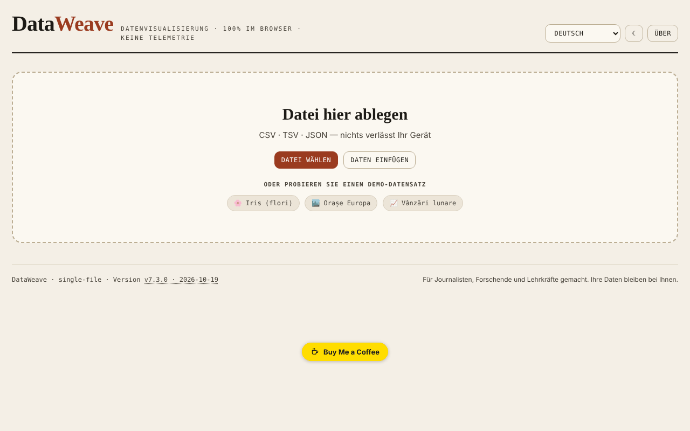

# DataWeave

[English](README.md) · [Română](README.ro.md) · [Français](README.fr.md) · [Italiano](README.it.md) · [Español](README.es.md) · [Português](README.pt.md) · **Deutsch** · [Magyar](README.hu.md)

**Version:** 7.3.0 · **Zuletzt aktualisiert:** 2026-10-19

Oberflächensprachen: **Română, English, Français, Italiano, Español, Português (PT), Deutsch, Magyar**

Werkstatt zur Visualisierung und Analyse tabellarischer Daten, direkt im Browser.

**Online-App:** https://chiuta.github.io/DataWeave/

## Was es ist

DataWeave ist eine HTML-Anwendung in einer einzigen Datei zum Erkunden von CSV-, TSV- und JSON-Dateien: Tabelle, Statistiken, Diagramme, Pivot-Tabelle und Korrelationen. Sie ist, wie die App selbst sagt, für Journalisten, Forscher und Lehrkräfte gedacht; Ihre Daten bleiben auf Ihrem Gerät.

## Funktionen

- Laden per Ziehen einer Datei, „Datei wählen“ oder „Daten einfügen“ (CSV, TSV, JSON); drei Demo-Datensätze: Iris (Blumen, die klassischen 150 Zeilen), Europäische Städte, Monatsumsätze.
- Die Reiter Tabelle (Sortierung per Klick irgendwo auf die Kopfzelle oder Enter/Leertaste auf dem Namen), Statistiken, Diagramme, Pivot, Korrelationen.
- Mehrfachfilter („+ Hinzufügen“, „Alles löschen“).
- Datenwerkzeuge: Duplikate entfernen, Leerzeichen bereinigen, berechnete Spalte, Spalten umordnen und ausblenden.
- Diagramme: Balken, Linie, Streudiagramm, Histogramm, Boxplot, Heatmap, Kreisdiagramm; Aggregationen (Summe, Mittelwert, Median, Anzahl, Min, Max, Standardabweichung), Farbe nach Spalte, Top-N, horizontal, Wertbeschriftungen, gestapelt.
- Regression (linear, logarithmisch, exponentiell, Potenz, polynomial vom Grad 2 und 3), Konfidenz- und Prognoseintervalle (90/95/99 %), Normalverteilungskurve, Mittelwert/Median, gleitender Durchschnitt.
- Pivot mit Zeilen, optionalen Spalten, Wert und Aggregation; CSV-Export.
- Pearson- oder Spearman-Korrelationen, mit SVG/PNG-Export.
- „Sitzung speichern“ / „Sitzung laden“; Export von Statistiken, JSON, CSV; Diagramme als SVG oder PNG.
- Berechnete Spalte mit arithmetischen Operatoren, Vergleichen, ternärem Operator und Funktionen (sqrt, log, log10, abs, round, floor, ceil, min, max, pow, exp, sin, cos, pi), ausgewertet ohne `eval`.
- Helles/dunkles Design (Schaltfläche ☾) und Oberfläche in 7 Sprachen: English, Română, Français, Italiano, Español, Português, Deutsch.

## Neue Funktionen (7.2.0)

- **Tabellensuche nach Relevanz** (BM25, Toleranz gegenüber Tippfehlern, Diakritika ignoriert), wenn die Tabelle keine manuelle Sortierung hat; die Anzeige zeigt „· nach Relevanz“. Sie gilt für höchstens 20000 Zeilen; über dieser Grenze bleibt die alte wörtliche Suche bestehen.
- **„Personenbezogene Daten“**: durchsucht lokal die sichtbaren Zellen (E-Mail, Telefon, IBAN, CNP, Karte, IP, Geheimnisse; optional Namen/Adressen, mit vielen Fehltreffern), zeigt eine Tabelle der Treffer an und exportiert eine CSV mit maskierten Werten (vollständiger oder teilweiser Ersatz). Die Ergebnisse sind nur Anhaltspunkte: Das Fehlen eines Treffers garantiert nicht, dass die Daten keine personenbezogenen Informationen enthalten.
- Die gemeinsamen „fff-kit“-Module sind enthalten (die Version in der Fußzeile öffnet den Transparenzdialog); die App nutzt keinen Speicher, daher hat der Sicherungsdialog nichts zu speichern.
- Die neuen Texte liegen in den 7 Sprachen der Oberfläche vor; **die Übersetzungen wurden nicht von Muttersprachlern überprüft.**

## Bedienungsanleitung

1. Wähle die Sprache im Sprachmenü.
2. Ziehe unter „Neue Daten“ eine CSV-/TSV-/JSON-Datei hinein, drücke „Datei wählen“ oder „Daten einfügen“ (dann „Laden“); alternativ wähle einen Demo-Datensatz.
3. Im Reiter Tabelle sortierst du per Klick auf die Kopfzeile; „+ Hinzufügen“ bei Filtern fügt eine Bedingung hinzu (Enter bestätigt).
4. Unter „Datenwerkzeuge“ kannst du Duplikate entfernen, Leerzeichen bereinigen, eine „+ Berechnete Spalte“ anlegen oder Spalten umordnen/ausblenden.
5. In Diagramme wählst du den Typ, die X- und Y-Achse und die Aggregation, dann optional die Regression oder die Intervalle; herunterladen mit „⬇ SVG“ / „⬇ PNG“.
6. In Pivot wählst du Zeilen, Spalten, Wert und Aggregation, dann „CSV exportieren“.
7. In Korrelationen wählst du die Methode (Pearson oder Spearman).
8. „Sitzung speichern“ sichert deine Arbeit in einer Datei, die du mit „Sitzung laden“ wieder aufnimmst.
9. Esc schließt die geöffneten Felder (Spaltenformular, Einfügebereich, Fenster „Über“).

## Datenschutz und Netzwerk

- Die App verwendet weder `localStorage`, `sessionStorage` noch IndexedDB und stellt keine Netzwerkanfragen (kein `fetch`, keine CDNs oder externen Skripte). Geladene Daten werden im Arbeitsspeicher verarbeitet und verschwinden beim Neuladen, außer was du über Exporte speicherst.
- Sie enthält nur Links, die per Klick geöffnet werden, zu Buy Me a Coffee und chiuta.github.io.

## Lokale / Offline-Ausführung

Lade `index.html` herunter und öffne die Datei im Browser; es ist kein Internet nötig.

## Verlauf / Changelog

### 7.2.0 — 14. Oktober 2026
- Tabellensuche nach Relevanz (FFF.search), bei erhaltener manueller Sortierung.
- „Personenbezogene Daten“: lokaler Scan und maskierter CSV-Export (FFF.pii).
- Gemeinsame Module core, label, bundle, search, pii; neue Tests: `tests/fff-r8.test.mjs`.

### 7.1.4 — 12. Oktober 2026
- Version und Datum der letzten Aktualisierung werden in der App angezeigt (Fußzeile).

### 7.1.3 — 11. Oktober 2026
- Der Demo-Datensatz Iris enthält jetzt die klassischen 150 Zeilen (vorher 20).
- Die Sortierung wird durch einen Klick irgendwo auf die Kopfzelle ausgelöst (nicht nur auf den Namen), hat `aria-sort` und funktioniert per Tastatur; die Typauswahl sortiert nicht.
- Korrektur der Schiefe (Skewness): Die korrigierte Formel verwendet bei der Standardisierung nun die Standardabweichung der Grundgesamtheit (geprüft gegen scipy `skew(bias=False)`).
- Die Standardabweichung ist in allen 7 Sprachen mit „(n−1)“ (Stichprobe) beschriftet.
- CSP: `connect-src 'none'` (die App stellt überhaupt keine Netzwerkanfragen).

### 7.1.2 — 11. Oktober 2026
- Sicherheit: Die berechnete Spalte verwendet einen eigenen Ausdrucksauswerter (ohne `eval`/`new Function`); die CSP-Richtlinie enthält für Skripte nicht mehr `'unsafe-eval'` und `'unsafe-inline'` (script-src per SHA-256-Hash), und `worker-src` ist `'none'`. Das Verhalten bestehender Formeln ist identisch (geprüft an 25 Ausdrücken).
- Formeln: neue Funktionen `floor`, `ceil`, `exp`, `log10`, `sin`, `cos`, die Konstante `pi` und der ternäre Operator `a>b?x:y`, mit aktualisiertem Hinweis in allen 7 Sprachen.
- Barrierefreiheit: Die Reiter sind nun per Tastatur bedienbar (Tab, Pfeile, Pos1/Ende, Enter/Leertaste), mit den ARIA-Rollen `tablist`/`tab`/`tabpanel`.
- Drucken: ein Druckstil, der nur das aktive Feld beibehält.

### 7.1.1 — 11. Oktober 2026
- Barrierefreiheit: h1-Überschrift, Hauptbereich (main), Beschriftungen für Sprachauswahl und Design-Schaltfläche, Statusbereich für Benachrichtigungen; axe-Prüfung ohne Verstöße.
- Reiter Korrelationen: erläuternde Legende und das stärkste Spaltenpaar, in allen 7 Sprachen.
- Versionsaktualisierung auf v7.1.1.

## Lizenz

MIT — siehe Datei LICENSE

## Autor

Alexio — Alexandru-Ionuț Chiuță, Kontakt: alexio@trom.tf

## Zusammenfassung auf Englisch

DataWeave ist eine HTML-Werkstatt in einer einzigen Datei zum Erkunden von CSV-, TSV- und JSON-Daten: Tabelle, Statistiken, Diagramme (Balken, Linie, Streudiagramm, Histogramm, Boxplot, Heatmap, Kreisdiagramm, mit Regression und Konfidenzintervallen), Pivot und Korrelationen. Sitzungen und Ergebnisse können exportiert werden. Oberfläche in 7 Sprachen. Es speichert nichts im Browser und stellt keine Netzwerkanfragen.
