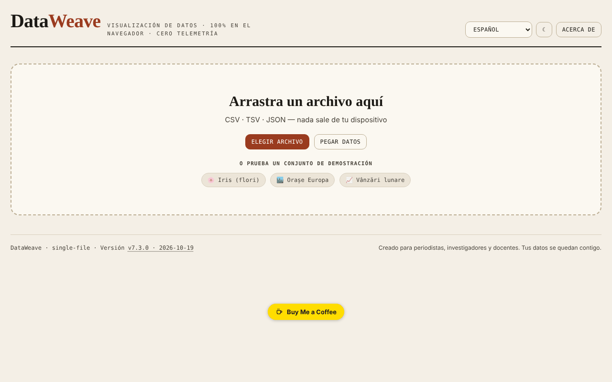

# DataWeave

[English](README.md) · [Română](README.ro.md) · [Français](README.fr.md) · [Italiano](README.it.md) · **Español** · [Português](README.pt.md) · [Deutsch](README.de.md) · [Magyar](README.hu.md)

**Versión:** 8.2.0 · **Última actualización:** 2026-10-27

**Estado:** estable · **Offline:** completo

Idiomas de la interfaz: **Română, English, Français, Italiano, Español, Português (PT), Deutsch, Magyar**

Taller de visualización y análisis de datos tabulares, directamente en el navegador.

**Aplicación en línea:** https://chiuta.github.io/DataWeave/

## Qué es

DataWeave es una aplicación HTML de un único archivo para explorar archivos CSV, TSV y JSON: tabla, estadísticas, gráficos, tabla dinámica y correlaciones. Está pensada, como dice la propia aplicación, para periodistas, investigadores y docentes; tus datos permanecen en tu dispositivo.

## Funciones

- Carga arrastrando un archivo, «Elegir archivo» o «Pegar datos» (CSV, TSV, JSON); tres conjuntos de demostración: Iris (flores, las 150 filas clásicas), Ciudades de Europa, Ventas mensuales.
- Las pestañas Tabla (ordenación con un clic en cualquier punto de la celda del encabezado o Intro/Espacio sobre el nombre), Estadísticas, Gráficos, Pivot, Correlaciones.
- Filtros múltiples («+ Añadir», «Borrar todo»).
- Herramientas de datos: eliminar duplicados, recortar espacios, columna calculada, reordenar y ocultar columnas.
- Gráficos: barras, líneas, dispersión, histograma, diagrama de caja, mapa de calor, circular; agregaciones (suma, media, mediana, recuento, mín., máx., desviación típica), color por columna, Top-N, horizontal, etiquetas de valores, apilado.
- Regresión (lineal, logarítmica, exponencial, potencial, polinómica de grado 2 y 3), intervalos de confianza y de predicción (90/95/99 %), curva normal, media/mediana, media móvil.
- Tabla dinámica con filas, columnas opcionales, valor y agregación; exportación CSV.
- Correlaciones de Pearson o de Spearman, con exportación SVG/PNG.
- «Guardar sesión» / «Cargar sesión»; exportación de estadísticas, JSON, CSV; gráficos como SVG o PNG.
- Columna calculada con operadores aritméticos, comparaciones, ternario y funciones (sqrt, log, log10, abs, round, floor, ceil, min, max, pow, exp, sin, cos, pi), evaluadas sin `eval`.
- Tema claro/oscuro (botón ☾) e interfaz en 7 idiomas: English, Română, Français, Italiano, Español, Português, Deutsch.

## Novedades (7.2.0)

- **Búsqueda en la tabla por relevancia** (BM25, tolerancia a errores de escritura, diacríticos ignorados), cuando la tabla no tiene una ordenación manual; el indicador muestra «· por relevancia». Se aplica a un máximo de 20000 filas; por encima de ese límite se mantiene la antigua búsqueda literal.
- **«Datos personales»**: analiza localmente las celdas visibles (correo electrónico, teléfono, IBAN, CNP, tarjeta, IP, secretos; opcionalmente nombres/direcciones, con muchos falsos positivos), muestra una tabla de coincidencias y exporta un CSV con los valores enmascarados (sustitución completa o parcial). Los resultados son orientativos: la ausencia de coincidencias no garantiza que los datos no contengan información personal.
- Se incluyen los módulos comunes «fff-kit» (la versión del pie de página abre el cuadro de transparencia); la aplicación no usa almacenamiento, por lo que el cuadro de copia de seguridad no tiene nada que guardar.
- Los textos nuevos están en los 7 idiomas de la interfaz; **las traducciones no han sido verificadas por hablantes nativos.**

## Manual de uso

1. Elige el idioma en el menú de idiomas.
2. En «Nuevos datos» arrastra un archivo CSV/TSV/JSON, pulsa «Elegir archivo» o «Pegar datos» (luego «Cargar»); como alternativa, elige un conjunto de demostración.
3. En la pestaña Tabla ordenas haciendo clic en el encabezado; «+ Añadir» en Filtros añade una condición (Intro confirma).
4. En «Herramientas de datos» puedes eliminar duplicados, recortar espacios, crear una «+ Columna calculada» o reordenar/ocultar columnas.
5. En Gráficos eliges el tipo, los ejes X e Y y la agregación, y opcionalmente la regresión o los intervalos; descarga con «⬇ SVG» / «⬇ PNG».
6. En Pivot eliges filas, columnas, valor y agregación, y luego «Exportar CSV».
7. En Correlaciones eliges el método (Pearson o Spearman).
8. «Guardar sesión» conserva el trabajo en un archivo, que retomas con «Cargar sesión».
9. Esc cierra los paneles abiertos (formulario de columna, zona de pegado, ventana «Acerca de»).

## Privacidad y red

- La aplicación no usa `localStorage`, `sessionStorage` ni IndexedDB y no realiza solicitudes de red (sin `fetch`, CDN ni scripts externos). Los datos cargados se procesan en memoria y desaparecen al recargar, salvo lo que guardes mediante las exportaciones.
- Solo contiene enlaces, abiertos al hacer clic, hacia Buy Me a Coffee y chiuta.github.io.

## Ejecución local / sin conexión

Descarga `index.html` y ábrelo en el navegador; no necesita internet.

## Historial / Changelog

- 7.3.5 — 2026-10-22: fff-kit 1.1.4: objetivos táctiles y tamaño mínimo de texto
- 7.3.4 — 2026-10-22: fff-kit 1.1.2: PBKDF2 600 000 iteraciones, protección anti-clickjacking
- 7.3.2 — 2026-10-22: **corrección**: los conjuntos de datos de demostración, los chips de ejemplo, el ejemplo de pegado, los contadores vacíos de filas/columnas y las etiquetas del selector de idioma siguen ahora el idioma elegido.
- 7.3.1 — 2026-10-22: **corrección**: el título de la página sigue ahora el idioma elegido.
### 7.3.3 — 2026-10-22
- Indicador «Datos en memoria» junto a la información del archivo (tamaño del texto cargado; memoria JS de la pestaña en el tooltip si el navegador la informa), aviso para archivos de más de 50 MB y mensaje si falla la lectura.
- Móvil: ningún texto por debajo de 12 px y áreas táctiles de al menos 24 px (WCAG 2.5.8).

### 7.2.0 — 14 de octubre de 2026
- Búsqueda en la tabla por relevancia (FFF.search), conservando la ordenación manual.
- «Datos personales»: análisis local y exportación CSV enmascarada (FFF.pii).
- Módulos comunes core, label, bundle, search, pii; nuevas pruebas: `tests/fff-r8.test.mjs`.

### 7.1.4 — 12 de octubre de 2026
- La versión y la fecha de la última actualización se muestran en la aplicación (pie de página).

### 7.1.3 — 11 de octubre de 2026
- El conjunto de demostración Iris contiene ahora las 150 filas clásicas (antes 20).
- La ordenación se activa con un clic en cualquier punto de la celda del encabezado (no solo sobre el nombre), tiene `aria-sort` y funciona con el teclado; el selector de tipo no ordena.
- Corrección de la asimetría (skewness): la fórmula ajustada usa ahora la desviación típica poblacional en la estandarización (verificada frente a scipy `skew(bias=False)`).
- La desviación típica se etiqueta «(n−1)» (muestra) en los 7 idiomas.
- CSP: `connect-src 'none'` (la aplicación no realiza ninguna solicitud de red).

### 7.1.2 — 11 de octubre de 2026
- Seguridad: la columna calculada usa un evaluador de expresiones propio (sin `eval`/`new Function`); la política CSP ya no contiene `'unsafe-eval'` ni `'unsafe-inline'` para los scripts (script-src por hash SHA-256), y `worker-src` es `'none'`. El comportamiento de las fórmulas existentes es idéntico (verificado con 25 expresiones).
- Fórmulas: nuevas funciones `floor`, `ceil`, `exp`, `log10`, `sin`, `cos`, la constante `pi` y el operador ternario `a>b?x:y`, con la pista actualizada en los 7 idiomas.
- Accesibilidad: las pestañas son ahora navegables con el teclado (Tab, flechas, Inicio/Fin, Intro/Espacio), con los roles ARIA `tablist`/`tab`/`tabpanel`.
- Impresión: un estilo de impresión que conserva solo el panel activo.

### 7.1.1 — 11 de octubre de 2026
- Accesibilidad: encabezado h1, zona principal (main), etiquetas para el selector de idioma y el botón de tema, región de estado para las notificaciones; verificación axe sin infracciones.
- Pestaña Correlaciones: leyenda explicativa y el par de columnas más fuerte, en los 7 idiomas.
- Actualización de la versión a v7.1.1.

## Licencia

MIT — véase el archivo LICENSE

## Autor

Alexio — Alexandru-Ionuț Chiuță, contacto: alexio@trom.tf

## Resumen

DataWeave es un taller HTML de un único archivo para explorar datos CSV, TSV y JSON: tabla, estadísticas, gráficos (barras, líneas, dispersión, histograma, diagrama de caja, mapa de calor, circular, con regresión e intervalos de confianza), tabla dinámica y correlaciones. Las sesiones y los resultados se pueden exportar. Interfaz en 7 idiomas. No almacena nada en el navegador y no realiza solicitudes de red.
