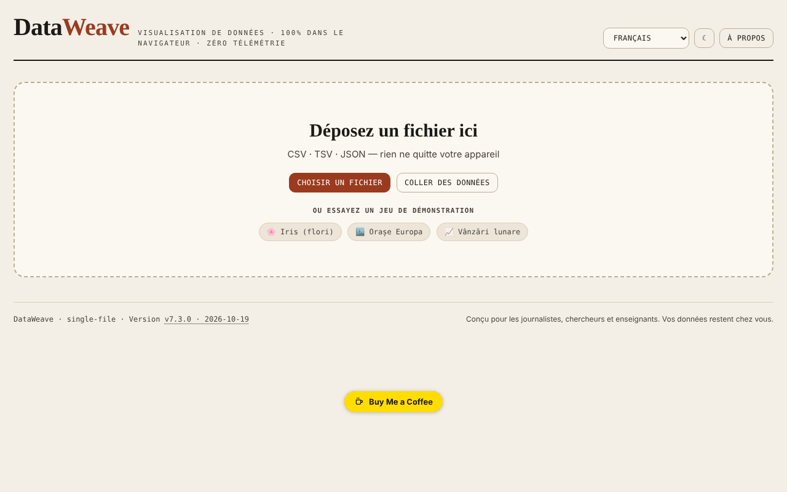

# DataWeave

[English](README.md) · [Română](README.ro.md) · **Français** · [Italiano](README.it.md) · [Español](README.es.md) · [Português](README.pt.md) · [Deutsch](README.de.md) · [Magyar](README.hu.md)

**Version :** 7.3.0 · **Dernière mise à jour :** 2026-10-19

Langues de l'interface : **Română, English, Français, Italiano, Español, Português (PT), Deutsch, Magyar**

Atelier de visualisation et d'analyse de données tabulaires, directement dans le navigateur.

**Application en ligne :** https://chiuta.github.io/DataWeave/

## Ce que c'est

DataWeave est une application HTML en un seul fichier pour explorer des fichiers CSV, TSV et JSON : tableau, statistiques, graphiques, tableau croisé dynamique et corrélations. Elle est conçue, comme le dit l'application, pour les journalistes, les chercheurs et les enseignants ; vos données restent sur votre appareil.

## Fonctionnalités

- Chargement par glisser-déposer d'un fichier, « Choisir un fichier » ou « Coller des données » (CSV, TSV, JSON) ; trois jeux de démonstration : Iris (fleurs, les 150 lignes classiques), Villes d'Europe, Ventes mensuelles.
- Les onglets Tableau (tri par clic n'importe où sur la cellule d'en-tête ou Entrée/Espace sur le nom), Statistiques, Graphiques, Pivot, Corrélations.
- Filtres multiples (« + Ajouter », « Tout effacer »).
- Outils de données : supprimer les doublons, nettoyer les espaces, colonne calculée, réordonner et masquer des colonnes.
- Graphiques : barres, courbe, nuage de points, histogramme, boîte à moustaches, carte thermique, secteurs ; agrégations (somme, moyenne, médiane, effectif, min, max, écart type), couleur par colonne, Top-N, horizontal, étiquettes de valeurs, empilé.
- Régression (linéaire, logarithmique, exponentielle, puissance, polynomiale de degré 2 et 3), intervalles de confiance et de prédiction (90/95/99 %), courbe normale, moyenne/médiane, moyenne mobile.
- Tableau croisé dynamique avec lignes, colonnes facultatives, valeur et agrégation ; export CSV.
- Corrélations de Pearson ou de Spearman, avec export SVG/PNG.
- « Enregistrer session » / « Charger session » ; export des statistiques, JSON, CSV ; graphiques en SVG ou PNG.
- Colonne calculée avec opérateurs arithmétiques, comparaisons, ternaire et fonctions (sqrt, log, log10, abs, round, floor, ceil, min, max, pow, exp, sin, cos, pi), évaluées sans `eval`.
- Thème clair/sombre (bouton ☾) et interface en 7 langues : English, Română, Français, Italiano, Español, Português, Deutsch.

## Nouveautés (7.2.0)

- **Recherche dans le tableau par pertinence** (BM25, tolérance aux fautes de frappe, diacritiques ignorés), lorsque le tableau n'a pas de tri manuel ; l'indicateur affiche « · par pertinence ». Elle s'applique à 20000 lignes au plus ; au-delà de cette limite, l'ancienne recherche littérale est conservée.
- **« Données personnelles »** : analyse localement les cellules visibles (e-mail, téléphone, IBAN, CNP, carte, IP, secrets ; en option noms/adresses, avec de nombreux faux positifs), affiche un tableau des correspondances et exporte un CSV aux valeurs masquées (remplacement complet ou partiel). Les résultats sont indicatifs : l'absence de correspondance ne garantit pas que les données ne contiennent aucune information personnelle.
- Les modules communs « fff-kit » sont inclus (la version dans le pied de page ouvre la boîte de dialogue de transparence) ; l'application n'utilise aucun stockage, donc la boîte de dialogue de sauvegarde n'a rien à enregistrer.
- Les nouveaux textes sont dans les 7 langues de l'interface ; **les traductions n'ont pas été vérifiées par des locuteurs natifs.**

## Mode d'emploi

1. Choisissez la langue dans le menu des langues.
2. Dans « Nouvelles données », glissez un fichier CSV/TSV/JSON, appuyez sur « Choisir un fichier » ou « Coller des données » (puis « Charger ») ; sinon, choisissez un jeu de démonstration.
3. Dans l'onglet Tableau, vous triez en cliquant sur l'en-tête ; « + Ajouter » sous Filtres ajoute une condition (Entrée confirme).
4. Dans « Outils de données », vous pouvez supprimer les doublons, nettoyer les espaces, créer une « + Colonne calculée » ou réordonner/masquer des colonnes.
5. Dans Graphiques, vous choisissez le type, les axes X et Y et l'agrégation, puis éventuellement la régression ou les intervalles ; téléchargez avec « ⬇ SVG » / « ⬇ PNG ».
6. Dans Pivot, vous choisissez les lignes, les colonnes, la valeur et l'agrégation, puis « Exporter CSV ».
7. Dans Corrélations, vous choisissez la méthode (Pearson ou Spearman).
8. « Enregistrer session » conserve votre travail dans un fichier, que vous reprenez avec « Charger session ».
9. Échap ferme les panneaux ouverts (formulaire de colonne, zone de collage, fenêtre « À propos »).

## Confidentialité et réseau

- L'application n'utilise ni `localStorage`, ni `sessionStorage`, ni IndexedDB et n'effectue aucune requête réseau (ni `fetch`, ni CDN, ni scripts externes). Les données chargées sont traitées en mémoire et disparaissent au rechargement, hormis ce que vous enregistrez par les exports.
- Elle ne contient que des liens, ouverts au clic, vers Buy Me a Coffee et chiuta.github.io.

## Exécution locale / hors ligne

Téléchargez `index.html` et ouvrez-le dans le navigateur ; aucune connexion internet n'est nécessaire.

## Historique / Changelog

### 7.2.0 — 14 octobre 2026
- Recherche dans le tableau par pertinence (FFF.search), avec conservation du tri manuel.
- « Données personnelles » : analyse locale et export CSV masqué (FFF.pii).
- Modules communs core, label, bundle, search, pii ; nouveaux tests : `tests/fff-r8.test.mjs`.

### 7.1.4 — 12 octobre 2026
- La version et la date de la dernière mise à jour sont affichées dans l'application (pied de page).

### 7.1.3 — 11 octobre 2026
- Le jeu de démonstration Iris contient désormais les 150 lignes classiques (20 auparavant).
- Le tri se déclenche par un clic n'importe où sur la cellule d'en-tête (et pas seulement sur le nom), dispose de `aria-sort` et fonctionne au clavier ; le sélecteur de type ne trie pas.
- Correction de l'asymétrie (skewness) : la formule ajustée utilise désormais l'écart type de la population pour la standardisation (vérifiée par rapport à scipy `skew(bias=False)`).
- L'écart type est étiqueté « (n−1) » (échantillon) dans les 7 langues.
- CSP : `connect-src 'none'` (l'application n'effectue aucune requête réseau).

### 7.1.2 — 11 octobre 2026
- Sécurité : la colonne calculée utilise un évaluateur d'expressions propre (sans `eval`/`new Function`) ; la politique CSP ne contient plus `'unsafe-eval'` ni `'unsafe-inline'` pour les scripts (script-src par hachage SHA-256), et `worker-src` vaut `'none'`. Le comportement des formules existantes est identique (vérifié sur 25 expressions).
- Formules : nouvelles fonctions `floor`, `ceil`, `exp`, `log10`, `sin`, `cos`, la constante `pi` et l'opérateur ternaire `a>b?x:y`, avec l'indice mis à jour dans les 7 langues.
- Accessibilité : les onglets sont désormais navigables au clavier (Tab, flèches, Début/Fin, Entrée/Espace), avec les rôles ARIA `tablist`/`tab`/`tabpanel`.
- Impression : un style d'impression qui ne conserve que le panneau actif.

### 7.1.1 — 11 octobre 2026
- Accessibilité : titre h1, zone principale (main), étiquettes pour le sélecteur de langue et le bouton de thème, région d'état pour les notifications ; vérification axe sans violation.
- Onglet Corrélations : légende explicative et paire de colonnes la plus fortement corrélée, dans les 7 langues.
- Mise à jour de la version en v7.1.1.

## Licence

MIT — voir le fichier LICENSE

## Auteur

Alexio — Alexandru-Ionuț Chiuță, contact : alexio@trom.tf

## Résumé en anglais

DataWeave est un atelier HTML en un seul fichier pour explorer des données CSV, TSV et JSON : tableau, statistiques, graphiques (barres, courbe, nuage de points, histogramme, boîte à moustaches, carte thermique, secteurs, avec régression et intervalles de confiance), tableau croisé dynamique et corrélations. Les sessions et les résultats peuvent être exportés. Interface en 7 langues. Il ne stocke rien dans le navigateur et n'effectue aucune requête réseau.
