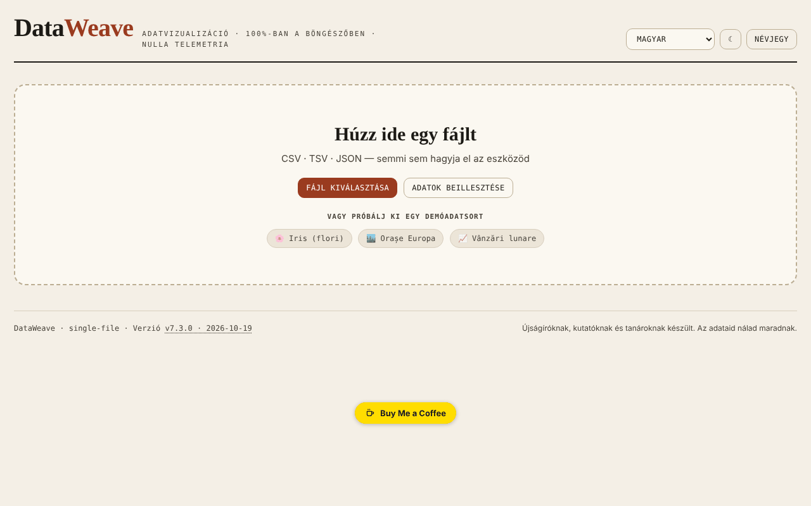

# DataWeave

[English](README.md) · [Română](README.ro.md) · [Français](README.fr.md) · [Italiano](README.it.md) · [Español](README.es.md) · [Português](README.pt.md) · [Deutsch](README.de.md) · **Magyar**

**Verzió:** 7.3.8 · **Utolsó frissítés:** 2026-10-26

A felület nyelvei: **Română, English, Français, Italiano, Español, Português (PT), Deutsch, Magyar**

Táblázatos adatok megjelenítésére és elemzésére szolgáló műhely, közvetlenül a böngészőben.

**Online alkalmazás:** https://chiuta.github.io/DataWeave/

## Mi ez

A DataWeave egyetlen fájlból álló HTML-alkalmazás CSV-, TSV- és JSON-fájlok felfedezéséhez: táblázat, statisztikák, diagramok, kimutatás (pivot) és korrelációk. Az alkalmazás megfogalmazása szerint újságíróknak, kutatóknak és tanároknak készült; az adataid az eszközödön maradnak.

## Funkciók

- Betöltés fájl behúzásával, „Fájl kiválasztása” vagy „Adatok beillesztése” útján (CSV, TSV, JSON); három bemutató adatkészlet: Iris (virágok, a klasszikus 150 sor), Európai városok, Havi eladások.
- A Táblázat fülek (rendezés a fejléccella bármely pontjára kattintva, vagy Enter/Szóköz a néven), Statisztikák, Diagramok, Pivot, Korrelációk.
- Többszörös szűrők („+ Hozzáadás”, „Mindet törli”).
- Adateszközök: duplikátumok eltávolítása, szóközök tisztítása, számított oszlop, oszlopok átrendezése és elrejtése.
- Diagramok: oszlop, vonal, pontdiagram, hisztogram, dobozdiagram, hőtérkép, kördiagram; összesítések (összeg, átlag, medián, darabszám, min, max, szórás), szín oszlop szerint, Top-N, vízszintes, értékfeliratok, halmozott.
- Regresszió (lineáris, logaritmikus, exponenciális, hatvány, 2. és 3. fokú polinomiális), konfidencia- és predikciós intervallumok (90/95/99%), normálgörbe, átlag/medián, mozgóátlag.
- Pivot sorokkal, opcionális oszlopokkal, értékkel és összesítéssel; CSV-export.
- Pearson- vagy Spearman-korrelációk, SVG/PNG-exporttal.
- „Munkamenet mentése” / „Munkamenet betöltése”; statisztikák, JSON, CSV exportja; diagramok SVG-ként vagy PNG-ként.
- Számított oszlop aritmetikai operátorokkal, összehasonlításokkal, hármas (ternáris) operátorral és függvényekkel (sqrt, log, log10, abs, round, floor, ceil, min, max, pow, exp, sin, cos, pi), `eval` nélkül kiértékelve.
- Világos/sötét téma (☾ gomb) és felület 7 nyelven: English, Română, Français, Italiano, Español, Português, Deutsch.

## Újdonságok (7.2.0)

- **Keresés a táblázatban relevancia szerint** (BM25, elgépelések tűrése, ékezetek figyelmen kívül hagyása), ha a táblázatnak nincs kézi rendezése; a jelző „· relevancia szerint” feliratot mutat. Legfeljebb 20000 sorra érvényes; e határ felett a régi szó szerinti keresés marad.
- **„Személyes adatok”**: helyben átvizsgálja a látható cellákat (e-mail, telefon, IBAN, CNP, kártya, IP, titkok; opcionálisan nevek/címek, sok téves találattal), találati táblázatot jelenít meg, és CSV-t exportál maszkolt értékekkel (teljes vagy részleges csere). Az eredmények tájékoztató jellegűek: a találat hiánya nem garantálja, hogy az adatok nem tartalmaznak személyes információt.
- A közös „fff-kit” modulok benne vannak (a láblécben lévő verzió megnyitja az átláthatósági párbeszédablakot); az alkalmazás nem használ tárolást, így a biztonsági mentés párbeszédablakának nincs mit mentenie.
- Az új szövegek a felület 7 nyelvén vannak; **a fordításokat nem ellenőrizték anyanyelvi beszélők.**

## Használati útmutató

1. Válaszd ki a nyelvet a nyelvi menüből.
2. Az „Új adatok” alatt húzz be egy CSV/TSV/JSON-fájlt, nyomd meg a „Fájl kiválasztása” vagy az „Adatok beillesztése” gombot (majd „Betöltés”); másik lehetőségként válassz egy bemutató adatkészletet.
3. A Táblázat fülön a fejlécre kattintva rendezel; a Szűrők alatti „+ Hozzáadás” új feltételt ad hozzá (az Enter jóváhagyja).
4. Az „Adateszközök” alatt eltávolíthatod a duplikátumokat, megtisztíthatod a szóközöket, létrehozhatsz egy „+ Számított oszlopot”, vagy átrendezhetsz/elrejthetsz oszlopokat.
5. A Diagramokban kiválasztod a típust, az X és Y tengelyt és az összesítést, majd opcionálisan a regressziót vagy az intervallumokat; letöltés a „⬇ SVG” / „⬇ PNG” gombbal.
6. A Pivotban kiválasztod a sorokat, oszlopokat, az értéket és az összesítést, majd „CSV exportálása”.
7. A Korrelációkban kiválasztod a módszert (Pearson vagy Spearman).
8. A „Munkamenet mentése” fájlba menti a munkádat, amelyet a „Munkamenet betöltése” gombbal folytathatsz.
9. Az Esc bezárja a megnyitott paneleket (oszlopűrlap, beillesztési terület, „Névjegy” ablak).

## Adatvédelem és hálózat

- Az alkalmazás nem használ `localStorage`-t, `sessionStorage`-t vagy IndexedDB-t, és nem kezdeményez hálózati kéréseket (nincs `fetch`, CDN vagy külső szkript). A betöltött adatok a memóriában kerülnek feldolgozásra, és újratöltéskor eltűnnek, kivéve azt, amit exportokkal elmentesz.
- Csak olyan hivatkozásokat tartalmaz, amelyek kattintásra nyílnak meg, a Buy Me a Coffee és a chiuta.github.io felé.

## Helyi / offline futtatás

Töltsd le az `index.html` fájlt, és nyisd meg böngészőben; nem igényel internetet.

## Előzmények / Changelog

- 7.3.5 — 2026-10-22: fff-kit 1.1.4: érintési célpontok és minimális szövegméret
- 7.3.4 — 2026-10-22: fff-kit 1.1.2: PBKDF2 600 000 iteráció, clickjacking elleni védelem
- 7.3.2 — 2026-10-22: **javítás**: a bemutató adathalmazok, a minta-chipek, a beillesztési példa, az üres sor-/oszlopszámlálók és a nyelvválasztó feliratai mostantól a kiválasztott nyelvet követik.
- 7.3.1 — 2026-10-22: **javítás**: az oldal címe mostantól a kiválasztott nyelvet követi.
### 7.3.3 — 2026-10-22
- „Adatok a memóriában” jelző a fájlinfó mellett (a betöltött szöveg mérete; a lap JS-memóriája a súgóban, ha a böngésző jelzi), figyelmeztetés 50 MB feletti fájlokra és üzenet, ha a fájl olvasása sikertelen.
- Mobil: nincs 12 px alatti szöveg, az érintési célpontok legalább 24 px-esek (WCAG 2.5.8).

### 7.2.0 — 2026. október 14.
- Keresés a táblázatban relevancia szerint (FFF.search), a kézi rendezés megtartásával.
- „Személyes adatok”: helyi vizsgálat és maszkolt CSV-export (FFF.pii).
- Közös modulok: core, label, bundle, search, pii; új tesztek: `tests/fff-r8.test.mjs`.

### 7.1.4 — 2026. október 12.
- A verzió és az utolsó frissítés dátuma megjelenik az alkalmazásban (lábléc).

### 7.1.3 — 2026. október 11.
- Az Iris bemutató adatkészlet mostantól a klasszikus 150 sort tartalmazza (korábban 20).
- A rendezést a fejléccella bármely pontjára kattintás kiváltja (nem csak a névre), van `aria-sort`-ja, és billentyűzetről is működik; a típusválasztó nem rendez.
- A ferdeség (skewness) javítása: a korrigált képlet a standardizálásnál mostantól a sokaság szórását használja (a scipy `skew(bias=False)` függvényhez képest ellenőrizve).
- A szórás minden 7 nyelven „(n−1)” (minta) címkét kapott.
- CSP: `connect-src 'none'` (az alkalmazás egyáltalán nem kezdeményez hálózati kéréseket).

### 7.1.2 — 2026. október 11.
- Biztonság: a számított oszlop saját kifejezéskiértékelőt használ (`eval`/`new Function` nélkül); a CSP-szabályzat már nem tartalmazza az `'unsafe-eval'` és `'unsafe-inline'` értéket a szkriptekhez (script-src SHA-256 hash alapján), a `worker-src` pedig `'none'`. A meglévő képletek viselkedése azonos (25 kifejezésen ellenőrizve).
- Képletek: új függvények: `floor`, `ceil`, `exp`, `log10`, `sin`, `cos`, a `pi` állandó és az `a>b?x:y` hármas operátor, a súgó frissítésével mind a 7 nyelven.
- Akadálymentesség: a fülek mostantól billentyűzettel navigálhatók (Tab, nyilak, Home/End, Enter/Szóköz), `tablist`/`tab`/`tabpanel` ARIA-szerepekkel.
- Nyomtatás: nyomtatási stílus, amely csak az aktív panelt tartja meg.

### 7.1.1 — 2026. október 11.
- Akadálymentesség: h1 címsor, főterület (main), címkék a nyelvválasztóhoz és a témagombhoz, állapotrégió az értesítésekhez; axe-ellenőrzés szabálysértés nélkül.
- Korrelációk fül: magyarázó jelmagyarázat és a legerősebb oszloppár, mind a 7 nyelven.
- Verziófrissítés v7.1.1-re.

## Licenc

MIT — lásd a LICENSE fájlt

## Szerző

Alexio — Alexandru-Ionuț Chiuță, kapcsolat: alexio@trom.tf

## Összefoglaló
A DataWeave egyetlen fájlból álló HTML-műhely CSV-, TSV- és JSON-adatok felfedezéséhez: táblázat, statisztikák, diagramok (oszlop, vonal, pontdiagram, hisztogram, dobozdiagram, hőtérkép, kördiagram, regresszióval és konfidenciaintervallumokkal), pivot és korrelációk. A munkamenetek és az eredmények exportálhatók. Felület 7 nyelven. Nem tárol semmit a böngészőben, és nem kezdeményez hálózati kéréseket.
