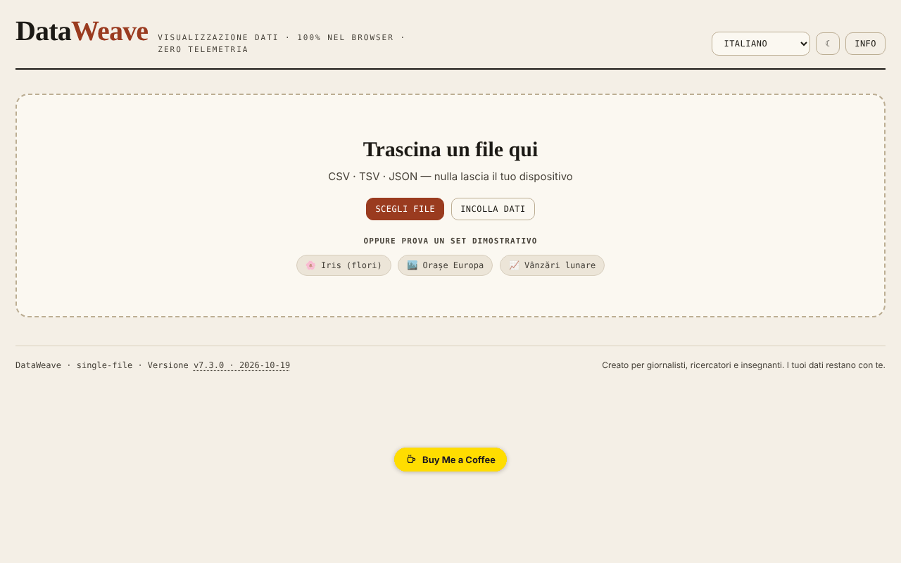

# DataWeave

[English](README.md) · [Română](README.ro.md) · [Français](README.fr.md) · **Italiano** · [Español](README.es.md) · [Português](README.pt.md) · [Deutsch](README.de.md) · [Magyar](README.hu.md)

**Versione:** 7.3.7 · **Ultimo aggiornamento:** 2026-10-23

Lingue dell'interfaccia: **Română, English, Français, Italiano, Español, Português (PT), Deutsch, Magyar**

Laboratorio di visualizzazione e analisi di dati tabellari, direttamente nel browser.

**Applicazione online:** https://chiuta.github.io/DataWeave/

## Che cos'è

DataWeave è un'applicazione HTML in un unico file per esplorare file CSV, TSV e JSON: tabella, statistiche, grafici, tabella pivot e correlazioni. È pensata, come dice l'applicazione stessa, per giornalisti, ricercatori e insegnanti; i dati restano sul tuo dispositivo.

## Funzioni

- Caricamento trascinando un file, «Scegli file» o «Incolla dati» (CSV, TSV, JSON); tre insiemi dimostrativi: Iris (fiori, le 150 righe classiche), Città europee, Vendite mensili.
- Le schede Tabella (ordinamento con un clic in qualsiasi punto della cella dell'intestazione o Invio/Spazio sul nome), Statistiche, Grafici, Pivot, Correlazioni.
- Filtri multipli («+ Aggiungi», «Cancella tutto»).
- Strumenti per i dati: elimina duplicati, rimuovi spazi, colonna calcolata, riordino e nascondimento delle colonne.
- Grafici: barre, linee, dispersione, istogramma, box plot, mappa di calore, torta; aggregazioni (somma, media, mediana, conteggio, min, max, deviazione standard), colore per colonna, Top-N, orizzontale, etichette dei valori, impilato.
- Regressione (lineare, logaritmica, esponenziale, potenza, polinomiale di grado 2 e 3), intervalli di confidenza e di predizione (90/95/99%), curva normale, media/mediana, media mobile.
- Pivot con righe, colonne facoltative, valore e aggregazione; esportazione CSV.
- Correlazioni di Pearson o di Spearman, con esportazione SVG/PNG.
- «Salva sessione» / «Carica sessione»; esportazione di statistiche, JSON, CSV; grafici come SVG o PNG.
- Colonna calcolata con operatori aritmetici, confronti, ternario e funzioni (sqrt, log, log10, abs, round, floor, ceil, min, max, pow, exp, sin, cos, pi), valutate senza `eval`.
- Tema chiaro/scuro (pulsante ☾) e interfaccia in 7 lingue: English, Română, Français, Italiano, Español, Português, Deutsch.

## Novità (7.2.0)

- 7.3.4 — 2026-10-22: fff-kit 1.1.2: PBKDF2 600.000 iterazioni, protezione anti-clickjacking
- **Ricerca nella tabella per rilevanza** (BM25, tolleranza agli errori di battitura, diacritici ignorati), quando la tabella non ha un ordinamento manuale; l'indicatore mostra «· per rilevanza». Si applica a un massimo di 20000 righe; oltre questo limite resta la vecchia ricerca letterale.
- **«Dati personali»**: scansiona localmente le celle visibili (e-mail, telefono, IBAN, CNP, carta, IP, segreti; facoltativamente nomi/indirizzi, con molti falsi positivi), mostra una tabella delle corrispondenze ed esporta un CSV con i valori mascherati (sostituzione completa o parziale). I risultati sono indicativi: l'assenza di una corrispondenza non garantisce che i dati non contengano informazioni personali.
- I moduli comuni «fff-kit» sono inclusi (la versione nel piè di pagina apre la finestra di trasparenza); l'applicazione non usa archiviazione, quindi la finestra di copia di riserva non ha nulla da salvare.
- I nuovi testi sono nelle 7 lingue dell'interfaccia; **le traduzioni non sono state verificate da madrelingua.**

## Guida all'uso

1. Scegli la lingua dal menu delle lingue.
2. In «Nuovi dati» trascina un file CSV/TSV/JSON, premi «Scegli file» o «Incolla dati» (poi «Carica»); in alternativa, scegli un insieme dimostrativo.
3. Nella scheda Tabella ordini con un clic sull'intestazione; «+ Aggiungi» in Filtri aggiunge una condizione (Invio conferma).
4. In «Strumenti dati» puoi eliminare i duplicati, rimuovere gli spazi, creare una «+ Colonna calcolata» o riordinare/nascondere colonne.
5. In Grafici scegli il tipo, gli assi X e Y e l'aggregazione, poi facoltativamente la regressione o gli intervalli; scarica con «⬇ SVG» / «⬇ PNG».
6. In Pivot scegli righe, colonne, valore e aggregazione, poi «Esporta CSV».
7. In Correlazioni scegli il metodo (Pearson o Spearman).
8. «Salva sessione» conserva il lavoro in un file, che riprendi con «Carica sessione».
9. Esc chiude i pannelli aperti (modulo della colonna, area di incollaggio, finestra «Informazioni»).

## Privacy e rete

- L'applicazione non usa `localStorage`, `sessionStorage` o IndexedDB e non effettua richieste di rete (nessun `fetch`, CDN o script esterno). I dati caricati vengono elaborati in memoria e scompaiono al ricaricamento, tranne ciò che salvi tramite le esportazioni.
- Contiene solo link, aperti al clic, verso Buy Me a Coffee e chiuta.github.io.

## Esecuzione locale / offline

Scarica `index.html` e aprilo nel browser; non ha bisogno di internet.

## Cronologia / Changelog

- 7.3.5 — 2026-10-22: fff-kit 1.1.4: target touch e dimensione minima del testo
- 7.3.2 — 2026-10-22: **correzione**: i dataset dimostrativi, i chip di esempio, l’esempio di incolla, i contatori vuoti di righe/colonne e le etichette del selettore di lingua seguono ora la lingua scelta.
- 7.3.1 — 2026-10-22: **correzione**: il titolo della pagina segue ora la lingua scelta.
### 7.3.3 — 2026-10-22
- Indicatore «Dati in memoria» accanto alle info del file (dimensione del testo caricato; memoria JS della scheda nel tooltip se il browser la riporta), avviso per file oltre 50 MB e messaggio se la lettura del file fallisce.
- Mobile: nessun testo sotto i 12 px e aree tattili di almeno 24 px (WCAG 2.5.8).

### 7.2.0 — 14 ottobre 2026
- Ricerca nella tabella per rilevanza (FFF.search), con conservazione dell'ordinamento manuale.
- «Dati personali»: scansione locale ed esportazione CSV mascherata (FFF.pii).
- Moduli comuni core, label, bundle, search, pii; nuovi test: `tests/fff-r8.test.mjs`.

### 7.1.4 — 12 ottobre 2026
- La versione e la data dell'ultimo aggiornamento sono mostrate nell'applicazione (piè di pagina).

### 7.1.3 — 11 ottobre 2026
- L'insieme dimostrativo Iris contiene ora le 150 righe classiche (prima 20).
- L'ordinamento si attiva con un clic in qualsiasi punto della cella dell'intestazione (non solo sul nome), ha `aria-sort` e funziona da tastiera; il selettore di tipo non ordina.
- Correzione dell'asimmetria (skewness): la formula corretta usa ora la deviazione standard della popolazione nella standardizzazione (verificata rispetto a scipy `skew(bias=False)`).
- La deviazione standard è etichettata «(n−1)» (campione) in tutte e 7 le lingue.
- CSP: `connect-src 'none'` (l'applicazione non effettua alcuna richiesta di rete).

### 7.1.2 — 11 ottobre 2026
- Sicurezza: la colonna calcolata usa un valutatore di espressioni proprio (senza `eval`/`new Function`); la policy CSP non contiene più `'unsafe-eval'` e `'unsafe-inline'` per gli script (script-src tramite hash SHA-256), e `worker-src` è `'none'`. Il comportamento delle formule esistenti è identico (verificato su 25 espressioni).
- Formule: nuove funzioni `floor`, `ceil`, `exp`, `log10`, `sin`, `cos`, la costante `pi` e l'operatore ternario `a>b?x:y`, con il suggerimento aggiornato in tutte e 7 le lingue.
- Accessibilità: le schede sono ora navigabili da tastiera (Tab, frecce, Home/End, Invio/Spazio), con ruoli ARIA `tablist`/`tab`/`tabpanel`.
- Stampa: uno stile di stampa che mantiene solo il pannello attivo.

### 7.1.1 — 11 ottobre 2026
- Accessibilità: titolo h1, area principale (main), etichette per il selettore di lingua e il pulsante del tema, regione di stato per le notifiche; verifica axe senza violazioni.
- Scheda Correlazioni: legenda esplicativa e la coppia di colonne più forte, in tutte e 7 le lingue.
- Aggiornamento della versione a v7.1.1.

## Licenza

MIT — vedi il file LICENSE

## Autore

Alexio — Alexandru-Ionuț Chiuță, contatto: alexio@trom.tf

## Riepilogo
DataWeave è un laboratorio HTML in un unico file per esplorare dati CSV, TSV e JSON: tabella, statistiche, grafici (barre, linee, dispersione, istogramma, box plot, mappa di calore, torta, con regressione e intervalli di confidenza), pivot e correlazioni. Sessioni e risultati possono essere esportati. Interfaccia in 7 lingue. Non memorizza nulla nel browser e non effettua richieste di rete.
