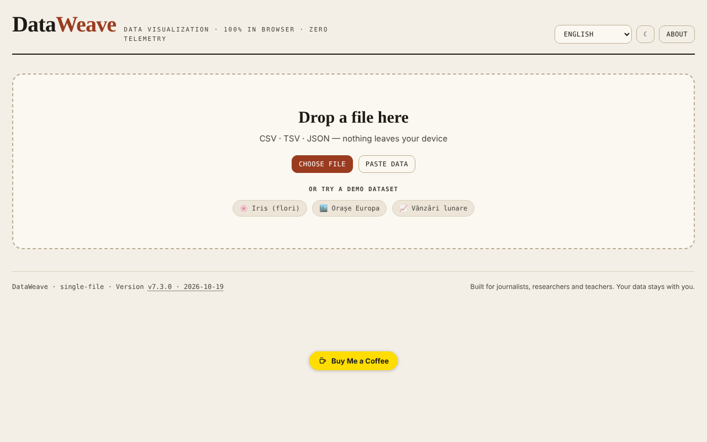

# DataWeave

**English** · [Română](README.ro.md) · [Français](README.fr.md) · [Italiano](README.it.md) · [Español](README.es.md) · [Português](README.pt.md) · [Deutsch](README.de.md) · [Magyar](README.hu.md)

**Version:** 8.2.1 · **Last updated:** 2026-10-28

**Status:** stable · **Offline:** complete

Interface languages: **Română, English, Français, Italiano, Español, Português (PT), Deutsch, Magyar**

A workshop for visualising and analysing tabular data, right in the browser.

**Live app:** https://chiuta.github.io/DataWeave/

## What it is

DataWeave is a single-file HTML application for exploring CSV, TSV, JSON and Excel (.xlsx) files: table, statistics, charts, pivot table and correlations. It is designed, as the app puts it, for journalists, researchers and teachers; your data stays on your device.

## Features

- Loading by dragging a file, "Choose file" or "Paste data" (CSV, TSV, JSON); three demo datasets: Iris (flowers, the classic 150 rows), European Cities, Monthly Sales.
- The Table tabs (sorting by clicking anywhere on the header cell or Enter/Space on the name), Statistics, Charts, Pivot, Correlations.
- Multiple filters ("+ Add", "Clear all").
- Data tools: remove duplicates, trim whitespace, computed column, reorder and hide columns.
- Charts: bar, line, scatter, histogram, box plot, heatmap, pie; aggregations (sum, mean, median, count, min, max, standard deviation), colour by column, Top-N, horizontal, value labels, stacked.
- Regression (linear, logarithmic, exponential, power, polynomial of degree 2 and 3), confidence and prediction intervals (90/95/99%), normal curve, mean/median, moving average.
- Pivot with rows, optional columns, value and aggregation; CSV export.
- Pearson or Spearman correlations, with SVG/PNG export.
- "Save session" / "Load session"; export of statistics, JSON, CSV; charts as SVG or PNG.
- Computed column with arithmetic operators, comparisons, ternary and functions (sqrt, log, log10, abs, round, floor, ceil, min, max, pow, exp, sin, cos, pi), evaluated without `eval`.
- Light/dark theme (the ☾ button) and interface in 7 languages: English, Română, Français, Italiano, Español, Português, Deutsch.
- **Excel import, `.xlsx` / `.xlsm` (8.1.0):** drag or choose a workbook; the first *visible* sheet is read, formulas show their last calculated value, dates are detected from the cell styles. Read entirely in the browser by a compact reader (ZIP via `DecompressionStream`, XML via `DOMParser`); no library, no network. Password-protected files are not supported.
- **Old Excel `.xls` (Excel 97-2003, BIFF8) (8.2.0):** read by a hand-written OLE2/BIFF8 reader (first visible sheet, text, numbers, RK, booleans, cached formula values, dates from the number formats, 1900/1904 systems). **Not read:** password-encrypted files (clear message), BIFF2-5 files (Excel 95 and older; clear message), macro/chart sheets. Tested only with files produced by LibreOffice (`MS Excel 97` filter), **not with files written by Microsoft Excel itself**; the encrypted/BIFF5 cases are simulated by editing one byte (detection only).
- **Parquet `.parquet` (8.2.0):** flat tables (no lists/maps/structs), data pages v1 and v2, encodings PLAIN, dictionary and RLE (booleans), compression **uncompressed, SNAPPY and GZIP**. Types: booleans, int32/int64 (exact, via BigInt), float/double, text, date, timestamp (ms/µs/ns, shown in UTC), decimal, INT96. **Not read (clear message):** ZSTD/LZ4/BROTLI/LZO compression, DELTA_* and BYTE_STREAM_SPLIT encodings, nested columns, encrypted files. Tested with files written by pyarrow 26 (not with Spark/DuckDB/Hive output); the whole file is read into memory (no streaming).
- **Performance test (8.1.0):** `tests/perf.test.mjs` generates synthetic CSVs (8 columns) in the page and measures loading and tab switching. Indicative run on a shared 2-vCPU container with a very high load (load average ≈ 37, so these are upper bounds; repeat on your machine): 50,000 rows (2.4 MB) ≈ 7 s to load; 200,000 rows (9.8 MB) ≈ 15 s; 500,000 rows (24.9 MB) ≈ 32 s, with JS memory around 290 MB; the Statistics and Correlations tabs grow roughly linearly with the rows. **Parsing and type inference run on the main thread (no Web Worker or streaming yet - planned)**, so the page is unresponsive while a large file loads.
- A fast path in number parsing (identical results, checked on 9,000 strings by the test) and the `.xlsx` note in the drop zone.
- Chart export as SVG/PNG already existed ("⬇ SVG" / "⬇ PNG").

## New features (7.2.0)

- **Table search by relevance** (BM25, tolerance for typos, diacritics ignored), when the table has no manual sort; the indicator shows "· by relevance". It applies to at most 20000 rows; above that limit the old literal search remains.
- **"Personal data"**: locally scans the visible cells (e-mail, phone, IBAN, CNP, card, IP, secrets; optionally names/addresses, with many false positives), displays a table of the matches and exports a CSV with masked values (full or partial replacement). The results are indicative: the absence of a match does not guarantee that the data contains no personal information.
- The shared "fff-kit" modules are included (the version in the footer opens the transparency dialog); the app uses no storage, so the backup dialog has nothing to save.
- The new texts are in the 7 interface languages; **the translations have not been checked by native speakers.**

## User guide

1. Choose the language from the language menu.
2. Under "New data" drag a CSV/TSV/JSON file, press "Choose file" or "Paste data" (then "Load"); alternatively, choose a demo dataset.
3. In the Table tab you sort by clicking the header; "+ Add" under Filters adds a condition (Enter confirms).
4. Under "Data tools" you can remove duplicates, trim whitespace, create a "+ Computed column" or reorder/hide columns.
5. In Charts you choose the type, the X and Y axes and the aggregation, then optionally the regression or the intervals; download with "⬇ SVG" / "⬇ PNG".
6. In Pivot you choose rows, columns, value and aggregation, then "Export CSV".
7. In Correlations you choose the method (Pearson or Spearman).
8. "Save session" keeps your work in a file, which you resume with "Load session".
9. Esc closes the open panels (column form, paste area, the "About" window).

## Privacy and network

- The app does not use `localStorage`, `sessionStorage` or IndexedDB and makes no network requests (no `fetch`, CDN or external scripts). Loaded data is processed in memory and disappears on reload, apart from what you save through exports.
- It contains only links, opened on click, to Buy Me a Coffee and chiuta.github.io.

## Running locally / offline

Download `index.html` and open it in a browser; it does not need internet.

## History / Changelog

### 8.2.0 — 2026-10-27
- Import of old Excel `.xls` (BIFF8) and Parquet (flat tables; uncompressed/Snappy/GZIP; PLAIN/dictionary) with hand-written readers, no library; clear messages for what is not read. Tests: `tests/xls-parquet.test.mjs` (38 checks, fixtures made with LibreOffice and pyarrow). Chart export to SVG/PNG already existed.

### 8.1.0 — 2026-10-27
- Excel import (`.xlsx`/`.xlsm`, first visible sheet) with a compact, dependency-free reader.
- Performance test `tests/perf.test.mjs` with indicative numbers in the README; fast path in number parsing.
- Not done: Parquet (planned), Web Worker / streaming (planned), old `.xls`.
- Already present: chart export to SVG/PNG. New test: `tests/xlsx.test.mjs`.

### 8.0.0 — 2026-10-26

- **Reproducible notebook** (new "Notebook" tab): every filter, "Remove duplicates", "Trim whitespace", computed column, type change, hide/reorder columns, sort and pivot is recorded as a step. Steps can be disabled, reordered, edited (filter value, formula) and deleted, with an immediate re-run on the loaded data.
- **Apply to another file…**: steps are re-run on another CSV/TSV/JSON (columns match by name; steps that do not apply are skipped and explained). **Notebook `.json` export/import** (no data), **JS script export** (Node 18+, no dependencies: it embeds the app's own functions, so it yields the same CSV; a pivot goes to a second CSV) and **SQL export** (CTE chain, PostgreSQL/standard; formulas without an SQL equivalent are marked TODO).
- Fixes: the app's CSV exports started with a `BOM` plus a comma (an empty leading header column); now just the `BOM`. "Remove duplicates" now keeps the raw source aligned (changing a column's type after deduplication gave wrong values).
- Limits: no joins between files; the loaded file text stays in page memory for re-runs (not saved).

- 7.3.5 — 2026-10-22: fff-kit 1.1.4: touch targets and minimum text size
- 7.3.4 — 2026-10-22: fff-kit 1.1.2: PBKDF2 600,000 iterations, anti-clickjacking protection
- 7.3.2 — 2026-10-22: **fix**: demo datasets, sample chips, paste example, empty row/column counters and language-selector labels now follow the selected language.
- 7.3.1 — 2026-10-22: **fix**: the page title now follows the selected language.
### 7.3.3 — 2026-10-22
- A "Data in memory" indicator next to the file info (loaded text size; the tab's JS memory in the tooltip when the browser reports it), a warning for files over 50 MB and a message if reading the file fails.
- Mobile: no text below 12 px and touch targets of at least 24 px (WCAG 2.5.8).

### 7.2.0 — 14 October 2026
- Table search by relevance (FFF.search), keeping manual sorting.
- "Personal data": local scan and masked CSV export (FFF.pii).
- Shared modules core, label, bundle, search, pii; new tests: `tests/fff-r8.test.mjs`.

### 7.1.4 — 12 October 2026
- The version and the date of the last update are shown in the app (footer).

### 7.1.3 — 11 October 2026
- The Iris demo dataset now contains the classic 150 rows (previously 20).
- Sorting is triggered by a click anywhere on the header cell (not only on the name), has `aria-sort` and works from the keyboard; the type selector does not sort.
- Skewness fix: the adjusted formula now uses the population standard deviation in standardisation (checked against scipy `skew(bias=False)`).
- The standard deviation is labelled "(n−1)" (sample) in all 7 languages.
- CSP: `connect-src 'none'` (the app makes no network requests at all).

### 7.1.2 — 11 October 2026
- Security: the computed column uses its own expression evaluator (no `eval`/`new Function`); the CSP no longer contains `'unsafe-eval'` and `'unsafe-inline'` for scripts (script-src by SHA-256 hash), and `worker-src` is `'none'`. The behaviour of existing formulas is identical (checked on 25 expressions).
- Formulas: new functions `floor`, `ceil`, `exp`, `log10`, `sin`, `cos`, the constant `pi` and the ternary operator `a>b?x:y`, with the hint updated in all 7 languages.
- Accessibility: tabs are now keyboard-navigable (Tab, arrows, Home/End, Enter/Space), with ARIA roles `tablist`/`tab`/`tabpanel`.
- Printing: a print style that keeps only the active panel.

### 7.1.1 — 11 October 2026
- Accessibility: h1 heading, main area (main), labels for the language selector and the theme button, status region for notifications; axe check without violations.
- Correlations tab: explanatory legend and the strongest pair of columns, in all 7 languages.
- Version updated to v7.1.1.

## License

MIT — see the LICENSE file

## Author

Alexio — Alexandru-Ionuț Chiuță, contact: alexio@trom.tf
