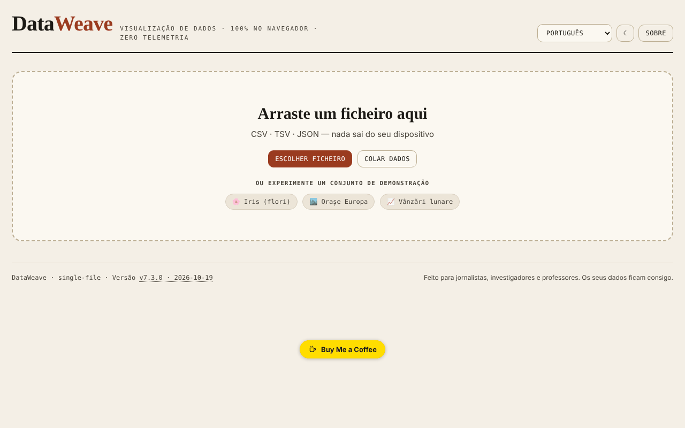

# DataWeave

[English](README.md) · [Română](README.ro.md) · [Français](README.fr.md) · [Italiano](README.it.md) · [Español](README.es.md) · **Português** · [Deutsch](README.de.md) · [Magyar](README.hu.md)

**Versão:** 7.3.2 · **Última atualização:** 2026-10-22

Idiomas da interface: **Română, English, Français, Italiano, Español, Português (PT), Deutsch, Magyar**

Oficina de visualização e análise de dados tabulares, diretamente no navegador.

**Aplicação online:** https://chiuta.github.io/DataWeave/

## O que é

O DataWeave é uma aplicação HTML num único ficheiro para explorar ficheiros CSV, TSV e JSON: tabela, estatísticas, gráficos, tabela dinâmica e correlações. Foi pensado, como diz a própria aplicação, para jornalistas, investigadores e professores; os seus dados ficam no seu dispositivo.

## Funcionalidades

- Carregamento por arrastamento de um ficheiro, «Escolher ficheiro» ou «Colar dados» (CSV, TSV, JSON); três conjuntos de demonstração: Iris (flores, as 150 linhas clássicas), Cidades da Europa, Vendas mensais.
- Os separadores Tabela (ordenação com um clique em qualquer ponto da célula do cabeçalho ou Enter/Espaço sobre o nome), Estatísticas, Gráficos, Pivot, Correlações.
- Filtros múltiplos («+ Adicionar», «Limpar tudo»).
- Ferramentas de dados: eliminar duplicados, remover espaços, coluna calculada, reordenar e ocultar colunas.
- Gráficos: barras, linhas, dispersão, histograma, diagrama de caixa, mapa de calor, circular; agregações (soma, média, mediana, contagem, mín., máx., desvio-padrão), cor por coluna, Top-N, horizontal, etiquetas de valores, empilhado.
- Regressão (linear, logarítmica, exponencial, potência, polinomial de grau 2 e 3), intervalos de confiança e de previsão (90/95/99%), curva normal, média/mediana, média móvel.
- Pivot com linhas, colunas opcionais, valor e agregação; exportação CSV.
- Correlações de Pearson ou de Spearman, com exportação SVG/PNG.
- «Guardar sessão» / «Carregar sessão»; exportação de estatísticas, JSON, CSV; gráficos como SVG ou PNG.
- Coluna calculada com operadores aritméticos, comparações, ternário e funções (sqrt, log, log10, abs, round, floor, ceil, min, max, pow, exp, sin, cos, pi), avaliadas sem `eval`.
- Tema claro/escuro (botão ☾) e interface em 7 idiomas: English, Română, Français, Italiano, Español, Português, Deutsch.

## Novidades (7.2.0)

- **Pesquisa na tabela por relevância** (BM25, tolerância a erros de escrita, diacríticos ignorados), quando a tabela não tem ordenação manual; o indicador mostra «· por relevância». Aplica-se a, no máximo, 20000 linhas; acima desse limite mantém-se a antiga pesquisa literal.
- **«Dados pessoais»**: analisa localmente as células visíveis (e-mail, telefone, IBAN, CNP, cartão, IP, segredos; opcionalmente nomes/moradas, com muitos falsos positivos), apresenta uma tabela das correspondências e exporta um CSV com os valores mascarados (substituição total ou parcial). Os resultados são indicativos: a ausência de correspondências não garante que os dados não contenham informações pessoais.
- Os módulos comuns «fff-kit» estão incluídos (a versão no rodapé abre a caixa de diálogo de transparência); a aplicação não usa armazenamento, pelo que a caixa de diálogo de cópia de segurança não tem nada para guardar.
- Os textos novos estão nos 7 idiomas da interface; **as traduções não foram verificadas por falantes nativos.**

## Manual de utilização

1. Escolha o idioma no menu de idiomas.
2. Em «Novos dados» arraste um ficheiro CSV/TSV/JSON, prima «Escolher ficheiro» ou «Colar dados» (depois «Carregar»); em alternativa, escolha um conjunto de demonstração.
3. No separador Tabela ordena clicando no cabeçalho; «+ Adicionar» em Filtros acrescenta uma condição (Enter confirma).
4. Em «Ferramentas de dados» pode eliminar duplicados, remover espaços, criar uma «+ Coluna calculada» ou reordenar/ocultar colunas.
5. Em Gráficos escolhe o tipo, os eixos X e Y e a agregação e, opcionalmente, a regressão ou os intervalos; descarregue com «⬇ SVG» / «⬇ PNG».
6. Em Pivot escolhe linhas, colunas, valor e agregação e depois «Exportar CSV».
7. Em Correlações escolhe o método (Pearson ou Spearman).
8. «Guardar sessão» conserva o trabalho num ficheiro, que retoma com «Carregar sessão».
9. Esc fecha os painéis abertos (formulário de coluna, zona de colagem, janela «Acerca de»).

## Privacidade e rede

- A aplicação não usa `localStorage`, `sessionStorage` nem IndexedDB e não faz pedidos de rede (sem `fetch`, CDN ou scripts externos). Os dados carregados são processados em memória e desaparecem ao recarregar, exceto o que guardar através das exportações.
- Contém apenas ligações, abertas ao clicar, para o Buy Me a Coffee e chiuta.github.io.

## Execução local / offline

Descarregue `index.html` e abra-o no navegador; não precisa de internet.

## Histórico / Changelog

- 7.3.2 — 2026-10-22: **correção**: os conjuntos de dados de demonstração, os chips de exemplo, o exemplo de colagem, os contadores vazios de linhas/colunas e os rótulos do seletor de idioma seguem agora o idioma escolhido.
- 7.3.1 — 2026-10-22: **correção**: o título da página segue agora o idioma escolhido.
### 7.2.0 — 14 de outubro de 2026
- Pesquisa na tabela por relevância (FFF.search), mantendo a ordenação manual.
- «Dados pessoais»: análise local e exportação CSV mascarada (FFF.pii).
- Módulos comuns core, label, bundle, search, pii; novos testes: `tests/fff-r8.test.mjs`.

### 7.1.4 — 12 de outubro de 2026
- A versão e a data da última atualização são apresentadas na aplicação (rodapé).

### 7.1.3 — 11 de outubro de 2026
- O conjunto de demonstração Iris contém agora as 150 linhas clássicas (antes 20).
- A ordenação é acionada por um clique em qualquer ponto da célula do cabeçalho (não apenas sobre o nome), tem `aria-sort` e funciona a partir do teclado; o seletor de tipo não ordena.
- Correção da assimetria (skewness): a fórmula ajustada usa agora o desvio-padrão populacional na estandardização (verificada face a scipy `skew(bias=False)`).
- O desvio-padrão está etiquetado «(n−1)» (amostra) nos 7 idiomas.
- CSP: `connect-src 'none'` (a aplicação não faz qualquer pedido de rede).

### 7.1.2 — 11 de outubro de 2026
- Segurança: a coluna calculada usa um avaliador de expressões próprio (sem `eval`/`new Function`); a política CSP já não contém `'unsafe-eval'` nem `'unsafe-inline'` para scripts (script-src por hash SHA-256), e `worker-src` é `'none'`. O comportamento das fórmulas existentes é idêntico (verificado em 25 expressões).
- Fórmulas: novas funções `floor`, `ceil`, `exp`, `log10`, `sin`, `cos`, a constante `pi` e o operador ternário `a>b?x:y`, com a dica atualizada nos 7 idiomas.
- Acessibilidade: os separadores são agora navegáveis pelo teclado (Tab, setas, Home/End, Enter/Espaço), com as funções ARIA `tablist`/`tab`/`tabpanel`.
- Impressão: um estilo de impressão que mantém apenas o painel ativo.

### 7.1.1 — 11 de outubro de 2026
- Acessibilidade: título h1, zona principal (main), etiquetas para o seletor de idioma e o botão de tema, região de estado para notificações; verificação axe sem violações.
- Separador Correlações: legenda explicativa e o par de colunas mais forte, nos 7 idiomas.
- Atualização da versão para v7.1.1.

## Licença

MIT — ver o ficheiro LICENSE

## Autor

Alexio — Alexandru-Ionuț Chiuță, contacto: alexio@trom.tf

## Resumo
O DataWeave é uma oficina HTML num único ficheiro para explorar dados CSV, TSV e JSON: tabela, estatísticas, gráficos (barras, linhas, dispersão, histograma, diagrama de caixa, mapa de calor, circular, com regressão e intervalos de confiança), tabela dinâmica e correlações. As sessões e os resultados podem ser exportados. Interface em 7 idiomas. Não guarda nada no navegador e não faz pedidos de rede.
