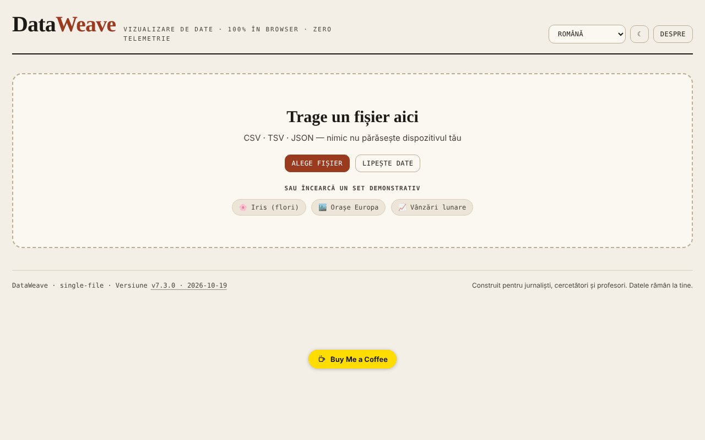

# DataWeave

[English](README.md) · **Română** · [Français](README.fr.md) · [Italiano](README.it.md) · [Español](README.es.md) · [Português](README.pt.md) · [Deutsch](README.de.md) · [Magyar](README.hu.md)

**Versiune:** 7.3.0 · **Ultima actualizare:** 2026-10-19

Limbile interfeței: **Română, English, Français, Italiano, Español, Português (PT), Deutsch, Magyar**

Atelier de vizualizare și analiză a datelor tabelare, direct în browser.

**Live:** https://chiuta.github.io/DataWeave/

## Ce este

DataWeave este o aplicație HTML dintr-un singur fișier pentru explorarea fișierelor CSV, TSV și JSON: tabel, statistici, grafice, tabel pivot și corelații. Este gândită, după cum spune aplicația, pentru jurnaliști, cercetători și profesori; datele rămân pe dispozitivul tău.

## Funcții

- Încărcare prin tragere de fișier, „Alege fișier" sau „Lipește date" (CSV, TSV, JSON); trei seturi demonstrative: Iris (flori, cele 150 de rânduri clasice), Orașe Europa, Vânzări lunare.
- Filele Tabel (sortare prin click oriunde pe celula antetului sau Enter/Spațiu pe nume), Statistici, Grafice, Pivot, Corelații.
- Filtre multiple („+ Adaugă", „Șterge tot").
- Unelte de date: elimină duplicate, curăță spații, coloană calculată, reordonare și ascundere coloane.
- Grafice: bare, linie, scatter, histogramă, box-plot, heatmap, plăcintă; agregări (sumă, medie, mediană, număr, min, max, deviație standard), culoare după coloană, Top-N, orizontal, etichete de valori, stivuit.
- Regresie (liniară, logaritmică, exponențială, putere, polinomială grad 2 și 3), intervale de încredere și de predicție (90/95/99%), curbă normală, medie/mediană, medie mobilă.
- Pivot cu rânduri, coloane opționale, valoare și agregare; export CSV.
- Corelații Pearson sau Spearman, cu export SVG/PNG.
- „Salvează sesiune" / „Încarcă sesiune"; export statistici, JSON, CSV; grafice ca SVG sau PNG.
- Coloană calculată cu operatori aritmetici, comparații, ternar și funcții (sqrt, log, log10, abs, round, floor, ceil, min, max, pow, exp, sin, cos, pi), evaluate fără `eval`.
- Temă luminoasă/întunecată (butonul ☾) și interfață în 7 limbi: English, Română, Français, Italiano, Español, Português, Deutsch.

## Funcții noi (7.2.0)

- **Căutare în tabel după relevanță** (BM25, toleranță la greșeli de scriere, diacritice ignorate), atunci când tabelul nu are o sortare manuală; indicatorul arată „· după relevanță”. Se aplică la cel mult 20000 de rânduri; peste această limită rămâne căutarea literală veche.
- **„Date personale”**: scanează local celulele vizibile (e-mail, telefon, IBAN, CNP, card, IP, secrete; opțional nume/adrese, cu multe false pozitive), afișează un tabel cu potrivirile și exportă un CSV cu valorile mascate (înlocuire completă sau parțială). Rezultatele sunt orientative: lipsa unei potriviri nu garantează că datele nu conțin informații personale.
- Modulele comune „fff-kit” sunt incluse (versiunea în subsol deschide dialogul de transparență); aplicația nu folosește stocare, deci dialogul de copie de siguranță nu are ce salva.
- Textele noi sunt în cele 7 limbi ale interfeței; **traducerile nu au fost verificate de vorbitori nativi.**

## Manual de utilizare

1. Alege limba din meniul de limbă.
2. În „Date noi" trage un fișier CSV/TSV/JSON, apasă „Alege fișier" sau „Lipește date" (apoi „Încarcă"); alternativ, alege un set demonstrativ.
3. În fila Tabel sortezi cu click pe antet; „+ Adaugă" la Filtre adaugă o condiție (Enter confirmă).
4. În „Unelte date" poți elimina duplicate, curăța spații, crea o „+ Coloană calculată" sau reordona/ascunde coloane.
5. În Grafice alegi tipul, axele X și Y și agregarea, apoi opțional regresia sau intervalele; descarcă cu „⬇ SVG" / „⬇ PNG".
6. În Pivot alegi rânduri, coloane, valoare și agregare, apoi „Export CSV".
7. În Corelații alegi metoda (Pearson sau Spearman).
8. „Salvează sesiune" păstrează lucrul într-un fișier, pe care îl reiei cu „Încarcă sesiune".
9. Esc închide panourile deschise (formular de coloană, zona de lipire, fereastra „Despre").

## Confidențialitate și rețea

- Aplicația nu folosește `localStorage`, `sessionStorage` sau IndexedDB și nu face cereri de rețea (fără `fetch`, CDN sau scripturi externe). Datele încărcate sunt prelucrate în memorie și dispar la reîncărcare, în afară de ce salvezi tu prin exporturi.
- Conține doar link-uri, deschise la click, către Buy Me a Coffee și chiuta.github.io.

## Rulare locală / offline

Descarcă `index.html` și deschide-l în browser; nu are nevoie de internet.

## Istoric / Changelog

### 7.2.0 — 14 octombrie 2026
- Căutare în tabel după relevanță (FFF.search), cu păstrarea sortării manuale.
- „Date personale”: scanare locală și export CSV mascat (FFF.pii).
- Module comune core, label, bundle, search, pii; teste noi: `tests/fff-r8.test.mjs`.

### 7.1.4 — 12 octombrie 2026
- Versiunea și data ultimei actualizări sunt afișate în aplicație (subsol).

### 7.1.3 — 11 octombrie 2026
- Setul demonstrativ Iris conține acum cele 150 de rânduri clasice (înainte 20).
- Sortarea se declanșează de la click oriunde pe celula antetului (nu doar pe nume), are `aria-sort` și funcționează de la tastatură; selectorul de tip nu sortează.
- Corecție la asimetrie (skewness): formula ajustată folosește acum abaterea standard a populației în standardizare (verificată față de scipy `skew(bias=False)`).
- Abaterea standard este etichetată „(n−1)” (eșantion) în toate cele 7 limbi.
- CSP: `connect-src 'none'` (aplicația nu face nicio cerere de rețea).

### 7.1.2 — 11 octombrie 2026
- Securitate: coloana calculată folosește un evaluator propriu de expresii (fără `eval`/`new Function`); politica CSP nu mai conține `'unsafe-eval'` și `'unsafe-inline'` pentru scripturi (script-src pe hash SHA-256), iar `worker-src` este `'none'`. Comportamentul formulelor existente este identic (verificat pe 25 de expresii).
- Formule: funcții noi `floor`, `ceil`, `exp`, `log10`, `sin`, `cos`, constanta `pi` și operatorul ternar `a>b?x:y`, cu indiciu actualizat în toate cele 7 limbi.
- Accesibilitate: filele sunt acum navigabile de la tastatură (Tab, săgeți, Home/End, Enter/Spațiu), cu roluri ARIA `tablist`/`tab`/`tabpanel`.
- Tipărire: stil de tipărire care păstrează doar panoul activ.

### 7.1.1 — 11 octombrie 2026
- Accesibilitate: titlu h1, zonă principală (main), etichete pentru selectorul de limbă și butonul de temă, regiune de stare pentru notificări; verificare axe fără încălcări.
- Fila Corelații: legendă explicativă și cea mai puternică pereche de coloane, în toate cele 7 limbi.
- Actualizare versiune la v7.1.1.

## Licență

MIT — vezi fișierul LICENSE

## Autor

Alexio — Alexandru-Ionuț Chiuță, contact: alexio@trom.tf

## Rezumat

DataWeave este un atelier într-un singur fișier HTML pentru explorarea datelor CSV, TSV și JSON: tabel, statistici, grafice (bare, linii, dispersie, histogramă, box-plot, hartă termică, plăcintă, cu regresie și intervale de încredere), pivot și corelații. Sesiunile și rezultatele pot fi exportate. 7 limbi de interfață. Nu stochează nimic în browser și nu face cereri de rețea.
